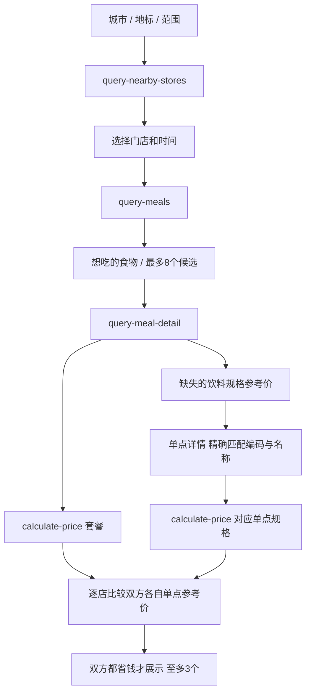

# MCP 接入说明

## 官方服务与安全边界

官方服务 `https://mcp.mcd.cn`，客户端为 `mcd_transport.py`，通过初始化协商 MCP 协议后发起 `tools/call`。凭据只从服务端 `MCD_TOKEN_FILE` 或 `MCD_TOKEN` 读取。没有把私有凭据读取脚本作为安装前提。

`mcp_gateway.py` 工具白名单：

| 官方工具 | 参数场景 | 实际业务价值 |
| --- | --- | --- |
| `query-nearby-stores` | city、keyword、orderType、beType 等实际 schema 参数 | 找门店、距离、营业与预约条件 |
| `query-meals` | storeCode、orderType=1、beType=1、reservationDate（预约时） | 取得门店与时段的菜单和候选套餐 |
| `query-meal-detail` | 上述上下文与 code | 精确拆解套餐、替换选项、单点饮料杯型 |
| `calculate-price` | 上述上下文与 items、needTableware=false | 官方试算套餐与单点规格，不是创建订单 |

参数以官方实时 schema 为准；门店搜索的具体组装见 market.py。凭据不进入 API 响应或前端。日志只记工具、门店、查询时刻和 traceId，不记 Authorization。

## 推荐调用链

单点参考价是菜单单项 currentPrice 或同店同时段单品试算所得；缺失不猜测。饮料必须精确匹配规格编码和名称；`可乐` 菜单起始价不能替代 `可乐中杯`。仅接受官方试算完整的单商品行和正整数分单位。

建议承担额：参考价齐全时按各自餐品参考价比例分摊套餐实付（整数分向上取整），多个门店取共同建议金额；每家店都单独验证双方严格省钱。单点信息不完整的候选不进入最终推荐。先按发起人承担额，再按剩余餐品评分排序。最多 8 个候选核验，非全菜单最优。

## 发布和领取

发布时再次核验各店组成、总价、附加费用和原报价一致，再消耗一次性报价生成邀请。报价属于发起身份，10 分钟过期。

领取先通过 SQLite `BEGIN IMMEDIATE` 条件更新为 checking 并提交，再调用官方 MCP 实时核价，不在网络等待期间持有数据库写锁。核价失败释放；价格变化返回 409 要求重新确认。只有持有占位的请求可提交 matched。180 秒占位超时可恢复；旧占位请求不能覆盖新占位。

领取成功确定一个门店，原先其他门店的同一邀请都不再展示。此锁只管理本项目数据，不是麦当劳库存锁。确认时还会核价；退出关闭整单。

## 本项目输出的 MCP

Streamable HTTP JSON-RPC `/mcp`；支持 initialize、ping、tools/list、tools/call；兼容协议 2025-03-26、2025-06-18、2025-11-25。无需服务器会话，GET 返回 405，无 SSE 推送。

| 工具 | 输入概要 | 输出与副作用 |
| --- | --- | --- |
| find_nearby_pending | city、keyword、radiusKm、taste、budgetCents | 查官方门店并返回本平台待拼单与推荐，不领取 |
| get_invitation | id | 邀请内容、门店、分配与状态 |
| claim_invitation | id、storeCode、expectedTotal（分）、name | 用户同意后占位并实时核价；改变本平台邀请状态，不产生官方订单 |

请求头 `X-Actor` 使用至少16位持久随机身份，不能复用官方 Token。匿名能力身份仅用于演示，不等同实名账号或正式权限体系。

## 真实调用记录

2026-10-23 在西安门店真实调用以上四个官方工具。可乐按小、中、大杯分别试算得 950、1000、1200 分；补齐中杯后，麦辣三件套形成双方均省钱的有效方案。最小脱敏记录在 docs/evidence/prices.json，包含门店、时间和 traceId，不含账号凭据或邀请能力令牌。

## 边界

不读取账号收藏或订单，不领券、绑券、购卡、下单或付款。报价可能受平台连接账号权益影响，不承诺所有账号价格一致。所需工具不可用时明确失败，不用演示数据冒充实时价格。
