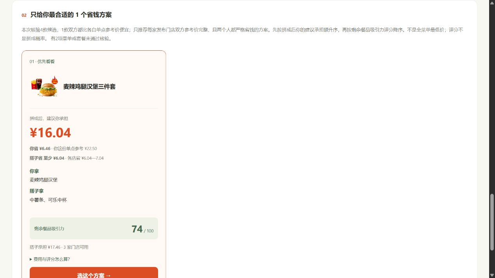
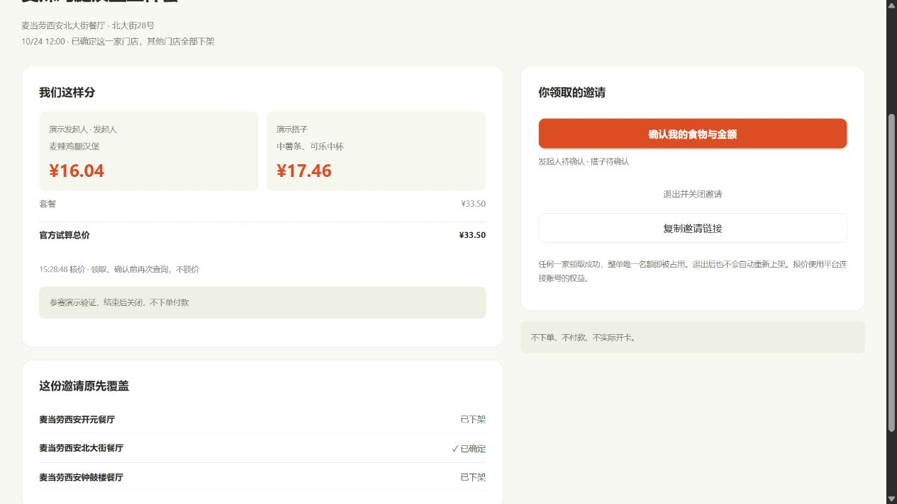
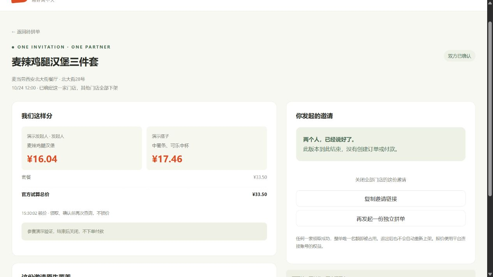

# 演示：两个人都省钱，一处领取全店关闭

[观看60秒演示 MP4](demo/pinghaomai-demo.mp4) · [在线交互版](https://www.harvey404.com/pinghaomai/)

视频是**真实浏览器操作截图按步骤编排的演示**，不是连续录屏。截图来自公开源码启动的隔离实例，使用真实官方 MCP 菜单和核价；昵称为测试角色，未创建订单或付款。两次验证邀请均已关闭。画面中的价格只代表查询当时，不保证后续供应。

## 0.3.0 社交演示补充

原60秒视频记录首次基线。当前版本在金额确认后继续展示双方完成、成功次数、站内榜、双人授权照片和再次约拼；新增操作与隔离测试截图见 [SOCIAL.md](SOCIAL.md)。首次基线截图中的“双方确认”是餐品金额确认，与当前“双方确认完成”分开。

## 60秒讲解词

| 时间 | 画面 | 讲解 |
| --- | --- | --- |
| 0–6秒 | 两个入口 | 拼好麦，让两个只想吃一部分套餐的人，各取所需。 |
| 6–18秒 | 双方省钱卡片 | 选附近门店和想吃的，只推荐双方都比各自单点便宜的方案。本次你省6.46元，搭子至少省6.04元。 |
| 18–26秒 | 食物和逐店报价 | 食物怎么分、每人承担多少、哪些店可用，都在发布前确认。 |
| 26–34秒 | 已发布邀请 | 一个邀请覆盖三家门店，只等一个搭子。 |
| 34–42秒 | 另一浏览器身份找单 | 另一人按附近门店、想吃的薯条和20元预算找到这一份。 |
| 42–50秒 | 领取成功 | 搭子选择北大街店，其他两家门店的同一邀请同步下架。 |
| 50–60秒 | 双方确认 | 两边分别确认分配。本作品到此结束，不进行真实下单或付款。 |

## 现场演示方法

1. 启动服务。发起人在普通浏览器打开页面，搭子使用无痕窗口；同机也可分别用127.0.0.1和localhost形成独立身份。
2. 发起人选择西安→商圈→钟楼，选择三家可用店，选官方允许的未来午餐时段。
3. 点麦辣鸡腿堡；若当时没有双方省钱方案，明确展示无结果，不能把历史价格当实时结果。
4. 选择有效推荐，填写“演示发起人”，发布。演示前确认不涉及真实下单付款。
5. 搭子查相同范围，输入薯条和预算，查看并领取其中一家。
6. 原浏览器刷新，确认门店已唯一确定。两边分别确认，然后关闭测试邀请。

线上待拼单由真实访问者自主发布，不预填假邀请。若首页暂无单，可用两个身份自发起一份演示邀请，结束后关闭。

## 可复核截图

视频素材、字幕与帧时长在本目录 demo/ 下，使用已安装的 FFmpeg 合成，不使用生成式画面。角色模拟与官方实时价格的边界在字幕中持续标注。
