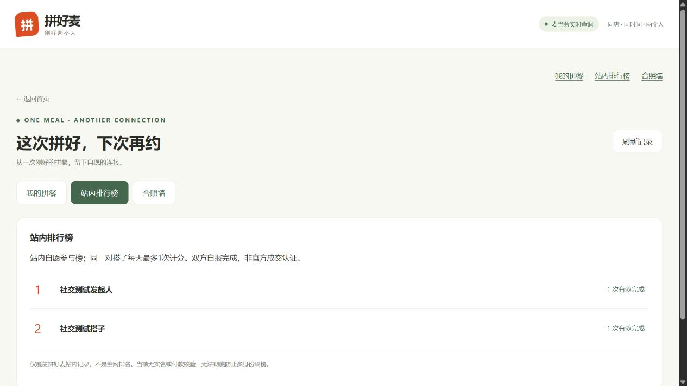
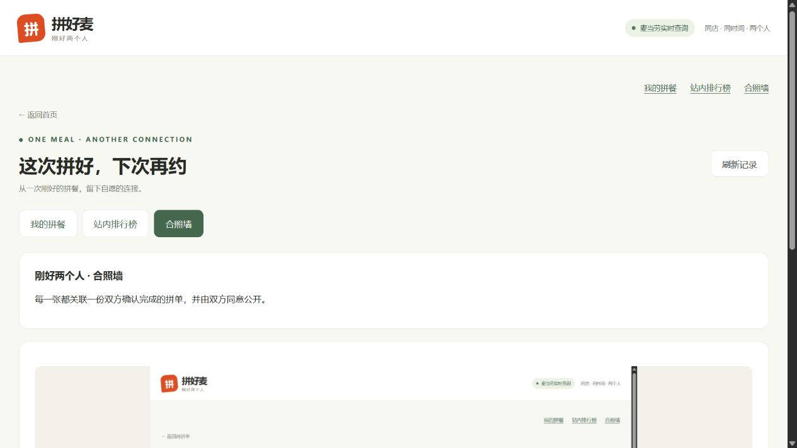

# 0.3.0 · 拼完这次，下次再约

实现与验证日期：2026-10-23。首页仍为“发起拼单”和“查看待拼单”两个主要入口；次级导航新增“我的拼餐、站内排行榜、合照墙”。

## 用户流程

1. 两人按原流程确认餐品与金额。这个状态不等于已经分餐完成。
2. 实际分餐或交接后，各自点击“我已完成分餐／交接”。单方点击只记录单方状态；双方都确认才生成一次成功记录。
3. “我的拼餐”显示成功次数和有效榜单记录数；发起人的待拼卡片也显示完成次数。
4. 自愿勾选参加站内榜，公开昵称和有效次数，随时可退出。相同两人每天最多一次计入榜单，完整成功记录仍逐单保留。
5. 任一方可选择照片，明确同意后上传。另一方查看同一版本并同意，才进入公开合照墙。任一方撤回立即停止公开；更换图片重置另一方同意。无需拍照、露脸或加入排行榜。
6. 完成后可向原搭子提出未来7天内、同一家店的再次约拼；对方接受或婉拒。接受后发起人重新选餐、通过官方MCP核价，再发布只有原搭子能查看和领取的定向新单。

再次约拼在站内“我的拼餐”接收，不发送短信、邮件或推送。不是自动下单，也不承诺价格沿用。

## 实现边界

- 成功次数指双方在本站自报完成，未核验官方订单、付款或实际见面。
- 当前为浏览器随机身份，清理存储或换浏览器会失去原身份；没有实名账户，日限制不能彻底阻止多身份刷榜。
- 站内榜仅统计本平台自愿加入者，不称“全网排名”；同次数按最近有效完成时间先后排序。
- 照片经浏览器缩小后转PNG，服务器校验尺寸、压缩像素流和CRC，重新编码移除附带元数据；私密预览要求参与者身份，公开图片接口不缓存。撤回无法收回别人已保存的副本。
- 数据保存在服务端SQLite；迁移只新增社交表，不改写旧邀请。完成记录按邀请ID唯一，使用事务抵御并发重复计数；一方开始完成确认后冻结撤销和重新确认餐品操作。
- 原官方工具白名单不变，没有增加下单、付款、购卡工具。本站社交接口是HTTP API；自身MCP的三个邀请工具保持原功能。

## 验证记录

自动测试使用隔离的MCP替身。新增16项覆盖独立确认、12路并发幂等、单方冻结、过期后完成、榜单自愿与日限制、照片双人授权/撤回/版本重置、非法与超限PNG、HTTP大图片与访问控制、再次约拼权限/过期/并发/重新报价/单次消费。公开源码测试总计57项。

另在8770端口、独立数据库中，用127.0.0.1与localhost两个浏览器身份操作真实官方MCP：

- 选西安开元、北大街、钟鼓楼三店，取餐时间2026-10-24 12:00；麦辣三件套33.50元，发起人16.04元，搭子17.46元。
- 搭子选择开元店，两边确认金额，分别模拟完成；单方不计，双方后各1次。
- 两身份主动加入站内榜后展示各1次。
- 上传标注“界面截图测试，非真实合照”的页面截图；单方同意时墙为空，双方同意后公开，撤回后下架。
- 再次约拼由原搭子接受，重新查询开元菜单、试算、发布定向新单并领取；新单测试结束关闭。

这些是隔离角色模拟，不是真实消费者见面或成交；没有把测试榜单或照片写入日常/线上数据库。

## 页面截图

以下均为隔离测试数据。





## 复现

用普通窗口与无痕窗口模拟双方（或127.0.0.1 / localhost两个站点）。先走完餐品金额确认，再分别模拟完成。演示测试应使用独立数据库，不伪装真实交易。自动测试运行：

```sh
python -m unittest discover -p 'test_*.py' -v
node --check public/app.js
node --check public/social.js
```
